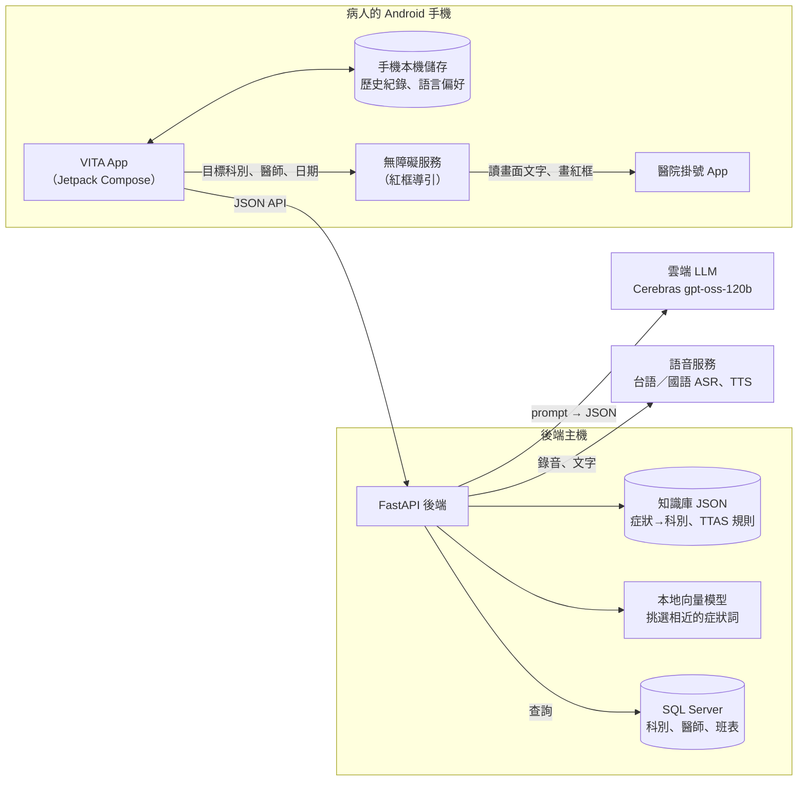
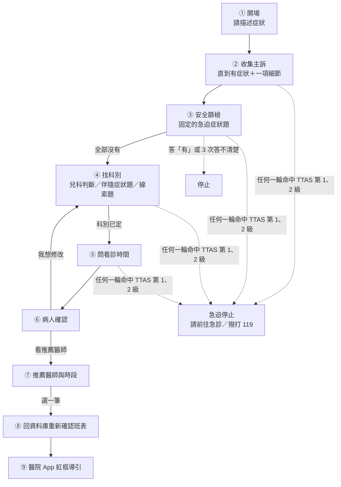

# VITA — Visual-guided Intelligent Triage Assistant

**導底看哪科－智慧看診指南**

> 用聊天幫病人找出該掛哪一科，再在醫院的掛號 App 上，用紅框一步一步帶他完成掛號。

> [!IMPORTANT]
> 本系統只提供「掛號導引」參考，**不是醫療診斷工具**，也沒有經過醫療人員的系統性臨床驗證。有急迫症狀時請立即就醫，情況危急請撥打 119。

---

## 1. 要解決的問題

| 問題 | 病人實際遇到的情況 |
|---|---|
| **不知道該掛哪一科** | 同樣是「頭暈」，可能要看耳科、神經內科或心臟內科。醫學中心的科別有上百個，病人常常掛錯科，或乾脆先掛家醫科再轉診。 |
| **掛號 App 不好操作** | 從「行動掛號」到「確認送出」要經過約 10 個畫面，長輩很容易卡在中間。 |
| **語言** | 部分長輩習慣說台語，不習慣打字。 |
| **安全** | 線上工具不能讓急症病人慢慢聊天、掛下週的門診。 |

VITA 的做法：**用一般聊天的方式問診 → 依醫院公開資料建議科別 → 從真實班表推薦醫師與時段 → 在醫院 App 上用紅框帶病人自己完成掛號**。整個過程可以用國語或台語。

---

## 2. 一分鐘看懂

一位病人實際會經歷的對話：

> **App**：請描述目前最主要的不舒服症狀。
> **病人**：我頭暈三天了
> **App**：請問是否有突發胸痛、嚴重呼吸困難、意識不清、大量出血、半邊無力或劇烈頭痛等急迫症狀？
> **病人**：都沒有
> **App**：請問您有沒有耳鳴、耳痛或耳聾（聽力變差）的情況，或以前曾被告知有？
> **病人**：有耳鳴
> （系統再問兩題，分辨是耳科還是神經內科）
> **App**：最近哪幾天、哪個時段比較方便看診？
> **病人**：下週三早上
> **App**：根據您剛才提到的症狀「頭暈」……因此目前建議您先看耳科。請確認後取得推薦掛號方案。
>
> 病人按「看推薦醫師」→ 看到醫師與時段 → 選一筆 → 按「前往掛號」
> → 手機打開醫院 App，畫面上用**紅框**一步一步標出下一個要點的地方。

---

## 3. 核心特色

### ① AI 只負責「聽懂人話」，判斷交給規則

AI 把病人的話整理成症狀、部位、多久、多嚴重等資料。後端會**逐筆驗證**：AI 引用的病人原話必須真的出現在對話裡、信心至少 0.55、格式正確，不合格的那一筆直接丟掉。
要不要停止問診、建議哪一科、什麼時候問完，都由後端程式規則決定，AI 不能替病人做決定。

### ② 每個科別建議都有官方依據

知識庫收錄醫院公開的「症狀 → 科別」資料，共 **3,424 筆、2,504 個症狀詞、42 個科別**，來自 11 家醫院或醫療體系的 258 個公開頁面（見第 7 節）。
系統建議的每一科，都追得回「病人說的哪一句話」對到「哪家醫院、哪個頁面」。知識庫裡沒有的科，系統不會推薦。

### ③ 安全優先

- 每一輪都用衛福部「台灣急診檢傷與急迫度分級（TTAS）」規則檢查；命中第 1、2 級就**立刻停止問診**，請病人前往急診或撥打 119。
- TTAS 有些情況需要醫護人員現場判斷（胸痛、半邊無力等），程式無法從文字確認，所以另外用一題**固定的安全篩檢題**直接問病人。答「有」就停止；答不清楚會重問，3 次都不清楚也停止。

### ④ 推薦來自真實班表

科別、醫師、班表都從 SQL Server 讀取，系統不會推薦資料庫裡沒有的科或時段。推薦分兩欄：「醫師專長優先」和「看診時間優先」。病人選定後，後端會**回資料庫再確認一次**班表還在，才進入掛號導引。

### ⑤ 紅框視覺導引，病人自己操作

透過 Android 無障礙服務讀取醫院 App 的畫面文字，在下一步要點的位置畫紅框。**系統不會代替病人點擊，也不會代填身分證號等個資**；到了個資表單，紅框會先隱藏，等病人自己填完再標出「確認送出」。

### ⑥ 國語、台語都能用

國語用手機內建語音辨識；台語錄音後送語音服務辨識。辨識出的文字只會填進輸入框，病人看過、按「送出」才算回答。每則訊息都可以按「播放」聽語音。

---

## 4. 系統架構



| 元件 | 負責 | 不負責 |
|---|---|---|
| Android App | 畫面、文字／語音輸入、播放語音、顯示推薦、存歷史紀錄、開啟醫院 App | 任何醫療判斷（急不急、看哪科都由後端決定） |
| 無障礙服務 | 在醫院 App 上讀畫面文字、用紅框標出下一步、偵測掛號成功畫面 | 自動點擊、代填個資 |
| 後端 API | 問診流程、驗證 AI、TTAS 急迫判斷、科別計分與決定、日期換算、查班表、排序、重新確認班表 | 畫面 |
| LLM | 聽懂病人的話、找意思相同的官方症狀詞、提出候選科別排名、寫追問句 | 決定流程、決定急迫、決定最終科別 |
| 知識庫 | 醫院公開的症狀→科別資料、TTAS 規則 | — |
| SQL Server | 科別、醫師、班表的真實資料 | — |

---

## 5. 問診流程

### 5.1 各個階段



病人每送出一句話，後端依序：

1. 請 AI 讀懂這句話（症狀、部位、多久、多嚴重、在回答哪一題、看診時間、是不是幫家人問）。
2. 逐筆驗證 AI 的結果，不合格的丟掉。
3. 跑 TTAS 規則，命中第 1、2 級就停止。
4. 重新計算候選科別與分數。
5. 決定下一句：安全篩檢題、年齡題、伴隨症狀題、線索題、看診時間題、確認句或停止句。

### 5.2 科別怎麼決定

1. **找候選科**：把病人的話和知識庫比對，有兩種方式，結果合併。
   - **字面比對**：官方症狀詞完整出現在病人的話裡。
   - **語意比對**：本地向量模型先替每句話挑出最相近的官方詞（最多 50 個），LLM 只能從這份短清單裡選意思相同的詞，再由第二次 LLM 審核（審核只能刪、不能加）。例：「拉肚子」可以對到「腹瀉」。
2. **過濾**：推薦的科必須看得了病人第一句說的主要症狀；沒有說部位的症狀，不能把病人帶到和部位無關的科；AI 不能把病人說的部位放大（例「大腿」不能放大成「下肢」）。
3. **計分**：某科分數 ＝ 支持這科的不同病人原話片段數 ＋ 病人答「有」的線索題數。沒有權重，AI 不參與計分。
4. **決定下一步**：

| 情況 | 系統怎麼做 |
|---|---|
| 就診者未滿 18 歲 | 依醫院就醫指引，建議先看兒科 |
| 幫家人問但沒說年齡 | 問一次「請問您兒子今年幾歲？」 |
| 病人指定科別 | 直接採用（安全篩檢照做） |
| 只剩一科 | 先問「還有沒有其他不舒服」，沒有新症狀就定這科 |
| 兩科以上 | 問**線索題**：用某一科的官方症狀詞問「有沒有…」，至少 3 題、最多 5 題，候選科輪流被問 |
| 完全對不到任何科 | 第 3 輪詢問病人要繼續描述，還是先掛家庭醫學科 |

### 5.3 例子：頭暈＋耳鳴

| 輪 | 病人 | 系統內部 | 系統說 |
|---|---|---|---|
| 1 | 最近一直頭暈，三天了 | 有症狀＋時間 → 進安全篩檢 | 安全篩檢題 |
| 2 | 都沒有 | 篩檢完成；「頭暈」對到 7 個科，各 1 分 | 線索題 1（耳科）：耳鳴、耳痛、耳聾？ |
| 3 | 有耳鳴，不會痛 | 耳科 2 分，其他 1 分 | 線索題 2（神經內科）：肌肉抽筋、走路不穩？ |
| 4 | 都沒有 | 分數不變 | 線索題 3（耳科） |
| 5 | 也沒有 | 問滿 3 題，耳科明確領先 → 定耳科 | 問看診時間 |

### 5.4 看診時間與推薦

- AI 只負責理解「下週三早上」「明天下午可以，後天不行」這類說法；**換算成真正的日期由後端計算**（以台北時區的今天為準），並在確認句列出換算結果，讓病人確認系統有沒有聽錯。
- 查詢範圍：這一科、從今天起 21 天內（病人指定更遠的日期就延長，最多 90 天）。排除請假、額滿、關診、當天已過截止時間的診，以及病人說不行的時間。
- 兩欄推薦：
  - **醫師專長優先**：最多 5 位醫師，每位最多 3 個時段。
  - **看診時間優先**：依病人的時間偏好分層排序，取前 5 筆。

---

## 6. 安全與倫理設計

| 設計 | 說明 |
|---|---|
| 不做診斷 | 系統只建議「先看哪一科」，不告訴病人得了什麼病。 |
| 急迫優先 | TTAS 第 1、2 級或安全篩檢答「有」，立刻停止問診，推薦與導引 API 也一律拒絕。 |
| AI 不能替病人確認 | 科別建議出來後，一定要病人自己按「看推薦醫師」才會往下。 |
| 不碰個資 | 紅框導引不代填、不標示個資欄位，也不自動點擊。 |
| 兒童先看兒科 | 依醫院公開的就醫指引，未滿 18 歲先建議兒科；是不是兒童由程式讀年齡判斷，不交給 AI 猜。 |
| 敏感問題不主動問 | 線索題不會主動問性病、癌症／腫瘤、懷孕相關的詞，病人自己說出口時才拿來找科別。 |
| 不亂猜 | 對不到官方資料時，不硬猜科別，改問病人是否先掛家庭醫學科。 |

---

## 7. 資料來源

### 7.1 症狀 → 科別知識庫

| 來源 | 說明 |
|---|---|
| 臺北榮民總醫院 | 主要來源：症狀衛教頁的「建議就診科別」、各科部衛教頁、「醫師及專長查詢」的專長關鍵字 |
| 臺中、高雄、屏東榮民總醫院及榮總分院 | 臺北榮總沒有對應資料時的補充 |
| 國軍醫院、衛福部雙和醫院 | 公立醫院的「我該看哪一科」資料 |
| 亞東、義大、新光、國泰醫院 | 私立醫院的科別與症狀對照 |

- 共 3,424 筆、2,504 個症狀詞、42 個科別、258 個來源頁面。
- 資料分兩種：醫院**寫明「這個症狀看哪科」**的可以拿來出線索題；科別專長說明、醫師專長、病名只用來計分，不出題（病人答不出病名）。
- 多個來源都有的症狀，依「臺北榮總 → 其他榮總 → 公立 → 私立」的順序決定線索題先問哪個詞。

### 7.2 急迫判斷

衛福部 TTAS 規則 64 條，其中 28 條可以從病人文字判斷、由程式執行；另外 36 條需要現場量測或臨床判斷，只作參考，改用固定安全篩檢題補足。

### 7.3 班表

科別、醫師、班表來自 SQL Server（資料表 `Department`、`DepartmentCategory`、`Doctor`、`Schedule`）。

---

## 8. 驗證

| 項目 | 結果 |
|---|---|
| 後端自動測試（pytest） | **1,154 個全部通過**（測試中不連真實 AI 與資料庫） |
| 語意比對短清單的找回率 | 102 句口語說法中，101 句的正確官方詞有被挑進短清單（`backend/benchmark/concept_shortlist_recall.py`） |
| 接真實 AI 與真實班表資料庫的對話實測 | 「我的屁股好痛」→ 復健醫學（依臺北榮總醫師專長「臀部疼痛」）；「我的腰好酸」3 次都建議復健醫學；「明天下午」「後天都可以」「明天下午可以，後天不行」「大後天早上」「下週三早上」都換算出正確日期；幫小孩問診會建議兒科 |

**沒有做的事**：沒有經過醫療人員的系統性臨床驗證，所以**不宣稱科別建議的準確率**。上面的實測只是開發過程中挑選的對話，不代表整體表現。

---

## 9. 技術棧

| 層 | 技術 |
|---|---|
| App | Kotlin、Jetpack Compose、Android AccessibilityService（minSdk 24、targetSdk 36） |
| 後端 | Python 3.11、FastAPI、Pydantic、Uvicorn |
| LLM | Cerebras `gpt-oss-120b`，溫度固定為 0（同一句話盡量得到同一個答案） |
| 本地向量模型 | `jinaai/jina-embeddings-v2-base-zh`（fastembed），用來替每句話挑出相近的官方症狀詞 |
| 資料庫 | Microsoft SQL Server（pyodbc、ODBC Driver 17） |
| 語音 | 手機內建語音辨識（國語）、外部語音服務（台語／國語 ASR 與 TTS）、App 內建預錄語音 |

---

## 10. 已知限制與未來方向

| 限制 | 影響 | 未來方向 |
|---|---|---|
| 沒有臨床驗證 | 科別建議的正確性沒有經過醫療人員系統性評估 | 請醫療人員審閱知識庫與實際對話 |
| 急迫判斷有漏網的可能 | 只執行 28 條 TTAS 規則，其餘靠安全篩檢題；病人誤答「沒有」時系統無法發現 | 結合量測資料（體溫、血壓等） |
| 知識庫涵蓋不到的說法 | 口語說法或沒有官方資料的部位（例「尾椎痛」）對不到科別，最後多半建議家庭醫學科 | 持續擴充官方來源 |
| 只依賴一家 LLM | LLM 服務中斷時無法問診 | 加入備援模型 |

---

## 11. 專案結構

```
backend/
  app/main.py                        啟動、註冊所有 API
  app/config.py                      可調整的設定（輪數上限、題數…）
  app/db.py                          所有 SQL 查詢
  app/routes/                        每個 API 的入口
  app/services/
    conversation_service.py          決定下一句問什麼（流程核心）
    rag_triage_adapter.py            請 AI 讀懂病人這一句
    department_reasoning_service.py  科別判定總流程
    department_clues.py              計分、線索題、定科規則
    concept_shortlist.py             語意比對前，先用本地模型挑出相近的官方詞
    pediatric_routing.py             未滿 18 歲先看兒科
    ttas_evaluator.py                TTAS 檢傷
    time_preference_service.py       看診時間換算
    appointment_service.py           查班表、排序推薦
    ai_service.py                    呼叫 LLM
  knowledge/                         知識庫與 TTAS 規則（JSON）
  tests/                             pytest 測試
  benchmark/                         對話跑分與找回率腳本
android/app/src/main/java/com/example/medicalaiguidance/
  screen/                            各個畫面
  viewmodel/                         畫面狀態與按鈕行為
  repository/                        呼叫後端、存歷史紀錄
  network/                           HTTP 與資料格式
  service/                           無障礙紅框導引（掛號、取消掛號）
  util/                              錄音、播放、內建預錄語音
```

---

## 12. API 一覽

| 方法 | 路徑 | 用途 |
|---|---|---|
| GET | `/health` | 後端是否啟動 |
| POST | `/chat` | 問診一輪（含確認、修改） |
| GET | `/chat/{case_id}/resume` | 從歷史紀錄續接未完成的問診 |
| POST | `/recommend` | 取得兩欄醫師與時段推薦 |
| POST | `/generate_script` | 回資料庫重新確認選定的班表 |
| GET | `/reference/departments` | 科別清單（快速查詢用） |
| GET | `/reference/doctors` | 指定科別的醫師清單 |
| GET | `/schedules/search` | 依科別、日期、時段查班表（快速查詢，不經問診） |
| POST | `/followup/recommend` | 舊版回診推薦（相容用） |
| POST | `/voice/asr` | 語音轉文字 |
| POST | `/voice/chat` | 語音問診（語音→問診→語音） |
| POST | `/voice/tts`、`/voice/tts/cleanup` | 文字轉語音、清除語音快取 |
| GET | `/voice/health` | 語音功能狀態 |
